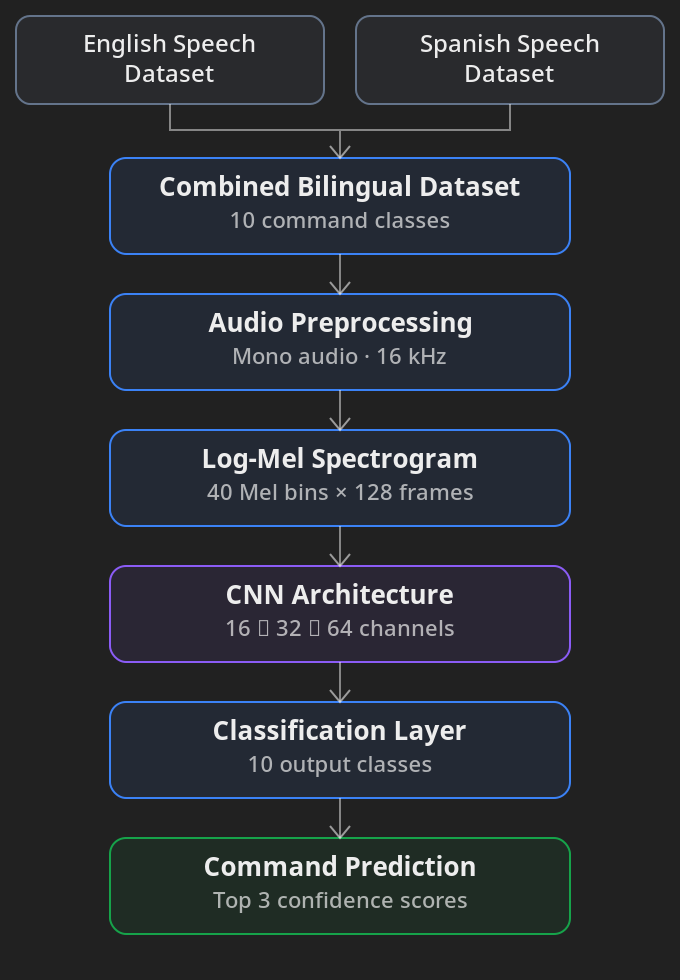
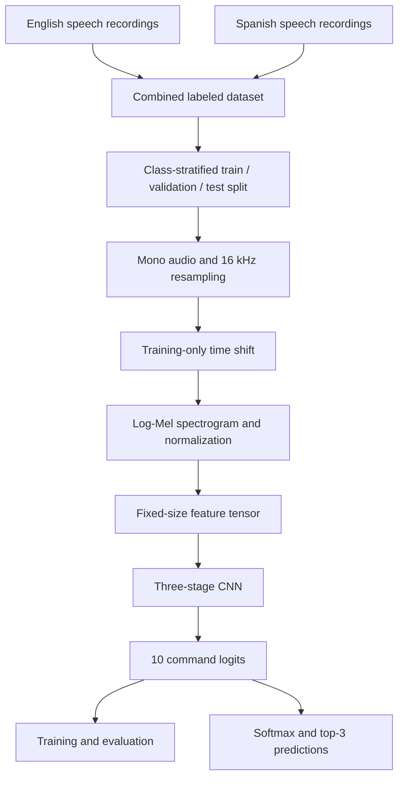

# Elderly Voice Command Recognition


An AI-powered bilingual speech command recognition system designed to explore accessible, hands-free interaction for older adults and people with visual impairments. The project uses a convolutional neural network (CNN) to classify short spoken commands in English and Spanish into a shared set of 10 command categories.

## Project Overview

Conventional digital interfaces often depend on visual controls or manual interaction. Voice-based interfaces can offer an alternative for users who find these controls difficult to operate.

This academic team project explores automatic speech recognition (ASR), specifically **keyword spotting**, as a foundation for assistive applications. It converts audio recordings into log-Mel spectrograms, learns discriminative audio features, and returns the most likely command together with model confidence scores.

Potential applications include accessible interfaces, voice-controlled devices, smart home systems, and assistive robotics. The current implementation is a command classifier, not a deployed navigation or device-control system.

## Key Features

- English and Spanish speech command classification using shared semantic labels.
- Recognition of 10 predefined commands.
- Audio preprocessing, normalization, and training-time temporal augmentation.
- Three-stage CNN with batch normalization, pooling, and dropout.
- GPU-accelerated training in Google Colab with CPU fallback.
- Evaluation using held-out accuracy, loss, learning curves, and a confusion matrix.
- WAV file upload demo with the predicted class and three highest-scoring commands.

## Supported Commands

The model maps utterances in either language to the following English output labels:

| Category | Command labels |
| --- | --- |
| Confirmation | `yes`, `no` |
| Direction | `up`, `down`, `left`, `right` |
| Device state | `on`, `off` |
| Movement | `stop`, `go` |

## System Architecture

<p align="center">
  
</p>

*Overview of the bilingual audio preprocessing, CNN classification, and command prediction pipeline.*



For validation, testing, and uploaded audio, the training-only time-shift operation is skipped.

## Datasets

| Dataset | Purpose |
| --- | --- |
| [Google Speech Commands](https://arxiv.org/abs/1804.03209) | English keyword recordings, loaded through TorchAudio. |
| [Multilingual Speech Commands - 15 Languages](https://huggingface.co/datasets/artur-muratov/multilingual-speech-commands-15lang-zip) | Spanish recordings selected by language and target command. |

The implementation combines available recordings and creates an approximately 80/10/10 training, validation, and test split stratified by command class. Spanish metadata entries without a corresponding extracted WAV file are excluded.

## Audio Preprocessing

| Parameter | Configuration |
| --- | --- |
| Target sample rate | 16,000 Hz |
| Audio channels | Mono |
| Mel frequency bands | 40 |
| FFT size | 512 |
| Hop length | 160 samples |
| Input dimensions | 1 x 40 x 128 (channels, Mel bins, time frames) |
| Augmentation | Random time shift of up to 100 ms during training |

Waveforms are converted to log-Mel features, standardized per recording, and padded or cropped to a consistent temporal dimension.

## Model Architecture and Training

The `ElderlyAssistCNN` model uses three convolutional blocks (16, 32, and 64 output channels). Each block includes normalization, ReLU activation, and max pooling. Global average pooling and dropout precede a fully connected 10-class output layer.

| Training parameter | Value |
| --- | --- |
| Framework | PyTorch |
| Optimizer | Adam |
| Loss | Cross-entropy |
| Learning rate | 0.001 |
| Batch size | 128 |
| Epochs | 10 |
| Dropout | 0.3 |
| Random seed | 42 |

## Technology Stack

| Technology | Role |
| --- | --- |
| Python | Model and data pipeline implementation |
| PyTorch | Neural network training and inference |
| TorchAudio / TorchCodec | Audio loading and feature extraction |
| Hugging Face Datasets | Multilingual dataset metadata |
| NumPy | Numerical operations |
| scikit-learn | Confusion matrix |
| Matplotlib | Learning curves and evaluation visualization |
| Google Colab | Training environment and interactive audio demo |

## Repository Structure

```text
Elderly-Voice-command/
├── fpcode_Team-3.py    # Training, evaluation, and prediction demo
├── fpr-Team-3.pdf      # Academic project report (PDF)
├── fpr-Team-3.docx     # Editable project report
└── README.md          # Project documentation
```

## Getting Started

### 1. Open Google Colab

Use [Google Colab](https://colab.research.google.com/) and create a notebook. Select a GPU runtime if available. The supplied Python file includes notebook-specific syntax and Colab-specific upload functionality, so it should be run in a notebook rather than directly with `python`.

### 2. Clone the repository

Run the following in a Colab code cell:

```python
!git clone https://github.com/Kartavya1905/Elderly-Voice-command.git
%cd /content/Elderly-Voice-command
```

### 3. Install dependencies

```python
%pip install torchcodec datasets matplotlib scikit-learn
```

Colab normally provides PyTorch and TorchAudio. If they are missing or incompatible, install mutually compatible versions of PyTorch, TorchAudio, and TorchCodec for the selected runtime.

### 4. Prepare the Spanish dataset

Download the command archives for `yes`, `no`, `up`, `down`, `left`, `right`, `on`, `off`, `stop`, and `go` from the [multilingual dataset repository](https://huggingface.co/datasets/artur-muratov/multilingual-speech-commands-15lang-zip/tree/main). Extract the relevant Spanish WAV recordings, preserving the paths referenced in the metadata:

```text
/content/multilingual-speech-commands-15lang-zip/
└── data_all/
    ├── yes/
    │   └── es_*.wav
    ├── no/
    │   └── es_*.wav
    └── ...
```

If the extracted dataset is stored elsewhere, update `MSC_REPO` in the source file. The metadata loader does not itself extract the Spanish audio archives. Check that the number of Spanish samples remaining after file validation is nonzero before training. The English dataset downloads automatically through TorchAudio.

### 5. Train and evaluate

Open `fpcode_Team-3.py` and copy its sections into Colab notebook cells in source order. Run the dependency installation magic in its own cell, then execute the data loading, preprocessing, model, training, and evaluation sections. Review the resulting sample counts and epoch logs.

### 6. Test an audio recording

Run the final upload-and-predict section and select a WAV recording containing one supported command. The model returns the highest-ranked command and the three largest softmax scores.

## Evaluation

The implementation produces training and validation accuracy/loss histories, final test accuracy and loss, and a 10-class confusion matrix. These outputs help reveal convergence behavior and command-level classification errors.

Numerical benchmark values are not reproduced here. See the [project report](./fpr-Team-3.pdf) and rerun the evaluation pipeline to verify results for a specific dataset configuration.

## Current Limitations and Future Work

- The current demo processes uploaded recordings, not a continuous microphone stream.
- The classifier has no explicit silence or unknown-command category; its confidence scores are not calibrated probabilities of correctness.
- The class-stratified split is not explicitly speaker-disjoint. Because the multilingual source includes augmented recordings, speaker- and original-recording-aware splits are needed for stronger generalization estimates.
- The current best-model tracking should use a deep copy of the state dictionary to retain the actual best validation epoch. Model weights are not exported as a standalone checkpoint by the existing script.
- Future work could include language-specific precision, recall and F1 scores, noise robustness testing, confidence rejection, real-time inference, and accessibility-focused user evaluation.

This is an academic proof of concept. It has not been validated for safety-critical navigation, mobility assistance, or medical use.

## Documentation and Credits

- [Project report (PDF)](./fpr-Team-3.pdf)
- [Project report (Word)](./fpr-Team-3.docx)
- [Speech Commands: A Dataset for Limited-Vocabulary Speech Recognition](https://arxiv.org/abs/1804.03209)
- [Multilingual Speech Commands dataset and original dataset citations](https://huggingface.co/datasets/artur-muratov/multilingual-speech-commands-15lang-zip)

Developed as an academic team project (Team 3). Dataset usage is subject to the respective source licenses. A separate software license is not currently included in the repository.
